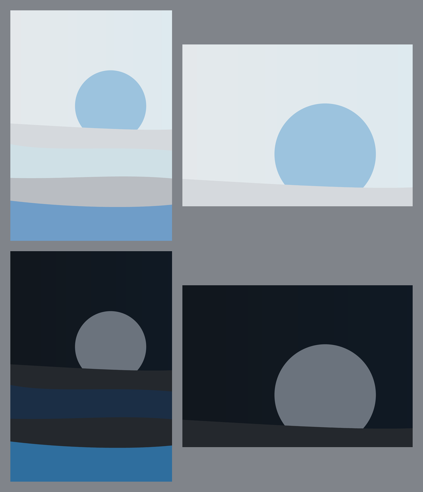

# iPhone Duo daily wallpapers

A new flat, abstract wallpaper every day, in a **light** version for daytime and a
**dark** version for night. Sized for the iPhone Duo inner display (1878 × 2670); the
outer display lines up with it. Only blues, teals, tans, khakis and greys.



## How it works

```
 00:00 CT  Claude routine ──► runs the duo-wallpaper skill
                              ├─ designs specs/<date>.json (style, colours, seed)
                              ├─ python generator/render.py ──► latest/light.png, latest/dark.png
                              ├─ reviews latest/preview.png, iterates if it's not good
                              └─ git commit + push
 Sunrise   iOS automation ──► downloads latest/light.png ──► Set Wallpaper Photo
 Sunset    iOS automation ──► downloads latest/dark.png  ──► Set Wallpaper Photo
```

GitHub is the hand-off between Claude and the phone. The image URLs never change:

- Light: `https://raw.githubusercontent.com/dkatz29/wallpapers/main/latest/light.png`
- Dark:  `https://raw.githubusercontent.com/dkatz29/wallpapers/main/latest/dark.png`
- Info:  `https://raw.githubusercontent.com/dkatz29/wallpapers/main/latest/manifest.json`

| Path | What |
|---|---|
| `.claude/skills/duo-wallpaper/SKILL.md` | The Claude skill: design brief and nightly steps |
| `generator/render.py` | Turns a spec into the light/dark PNGs; enforces size and palette |
| `specs/` | One JSON spec per day. Any past wallpaper can be re-rendered from it |
| `latest/` | Today's `light.png`, `dark.png`, `preview.png`, `manifest.json` |

Only the specs are archived. Past images can be rebuilt exactly with
`python generator/render.py specs/<date>.json --out tmp/`.

## iOS Shortcut setup (one time, about 5 minutes)

**Before you start:** set any **photo** wallpaper once by hand (Settings → Wallpaper).
The *Set Wallpaper Photo* action updates the current photo wallpaper.

### Two automations, no separate shortcut

The sunrise/sunset trigger already decides light vs dark, so each automation
downloads its own fixed URL. There's no shortcut input to go blank.

Shortcuts → **Automation** → **+** → **Time of Day** → choose the trigger, **Daily**,
**Run Immediately**, *Notify When Run* off → **New Blank Automation**:

| Trigger | Action 1: Get Contents of URL | Action 2: Set Wallpaper Photo |
|---|---|---|
| **Sunrise** | `https://raw.githubusercontent.com/dkatz29/wallpapers/main/latest/light.png` | *Contents of URL* · Lock Screen and Home Screen · *Show Preview* off · *Crop to Subject* off |
| **Sunset** | `https://raw.githubusercontent.com/dkatz29/wallpapers/main/latest/dark.png` | same |

Test with ▶ inside the automation. If the wallpaper doesn't change, temporarily add
**Quick Look** between the two actions to see what was downloaded, and make sure the
current wallpaper is a *photo* wallpaper.

The midnight job replaces `latest/` around 00:00 CT. Sunset always uses the dark
version of that day's design, and the next sunrise picks up the new one.

## The midnight Claude routine

A scheduled Claude Code routine runs daily at 00:00 America/Chicago against this
repo with this prompt:

> Use the duo-wallpaper skill to design, render, review and push today's wallpaper.

To run it by hand from a clone: open Claude Code in the repo and say
*"generate today's Duo wallpaper"*.

## Local use

```bash
pip install -r requirements.txt
python generator/render.py --palette              # allowed colour names
python generator/render.py specs/2026-11-16.json   # renders into latest/
```
